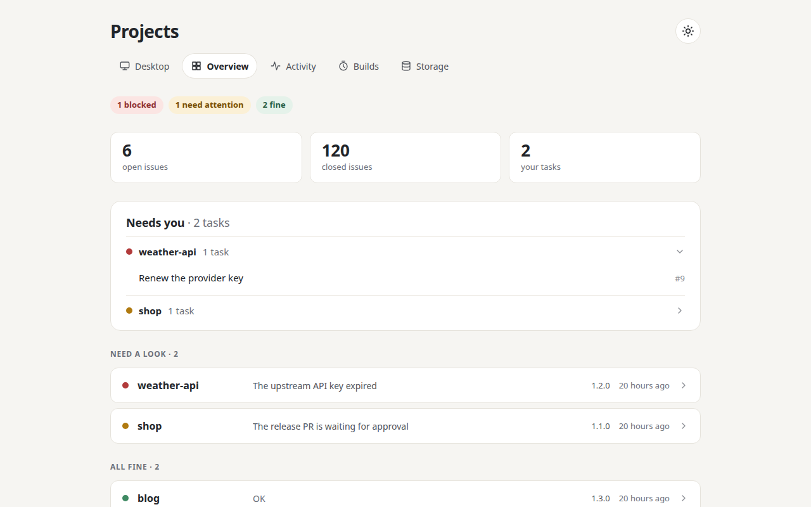

# projects-desk

A private dashboard of all your projects, kept up to date by the Claude Code
sessions that work on them.



Each project's Claude Code session writes one small JSON file: versions,
health, what is waiting on you, next steps. A watcher on your computer copies
those files into a Cloudflare D1 database, and a Cloudflare Worker renders the
page from D1 on every request. A status change shows on the next page load,
with no commit and no deploy.

## What you get

- **Desktop**: an icon for each project's live app.
- **Overview**: what needs you, across every project.
- **Activity and Builds**: commits, lines changed and build times per project,
  plus GitHub Actions usage per account.
- **Storage** (optional): used and free space on your disks, servers, rclone
  remotes, D1 and R2.
- **A page per project**, with its owner tasks, issues and next steps.
- **An installable app** (PWA) that also works on a phone.
- **Claude Code sessions on demand** (optional): open and close one tmux session
  per project, reachable from your phone over Remote Control.

There is no framework. The only dependency is `wrangler`.

## What you need

- A Linux computer with a systemd user session. The watcher and timers run there.
- Node.js, `git`, `gh` (logged in), `curl`, `jq`, `flock`.
- A Cloudflare account with a domain on it. The Worker, D1 and Access all run on
  Cloudflare.
- Claude Code, for the sessions that write the status files.

The page lists private issue titles, so it must not be public. The setup puts it
behind Cloudflare Access, and `scripts/deploy.sh` fails a deploy if a custom
domain answers without an Access login.

## Get started

```sh
git clone <this repository> projects-desk
cd projects-desk
npm install
npm test
npm run dev   # http://localhost:8787, an empty dashboard from local files
```

Then follow [docs/SETUP.md](docs/SETUP.md) to create the database, protect the
domain, deploy and install the watcher. After that,
[docs/CLAUDE_CODE.md](docs/CLAUDE_CODE.md) has the text that tells your Claude
Code sessions to write their status files.

The status file format is in
[STATUS_INSTRUCTIONS.md](STATUS_INSTRUCTIONS.md). Internals are in
[CLAUDE.md](CLAUDE.md).

## The Claude usage tab

An optional tab shows your Claude plan limits and which projects used them. It
is **off by default** (`"claude": false` in `desk.config.json`).

It reads `api.anthropic.com/api/oauth/usage`, the endpoint Claude Code's own
`/usage` command reads, using the Claude login on your computer. **That endpoint
is unofficial and undocumented.** It can change or disappear at any time, and it
may not be something Anthropic intends other tools to call, so read the terms
that apply to your plan before turning this on. The token is never logged or
stored, and a changed response shows as a problem on the tab with the last good
reading kept.

## License

[MIT](LICENSE)
