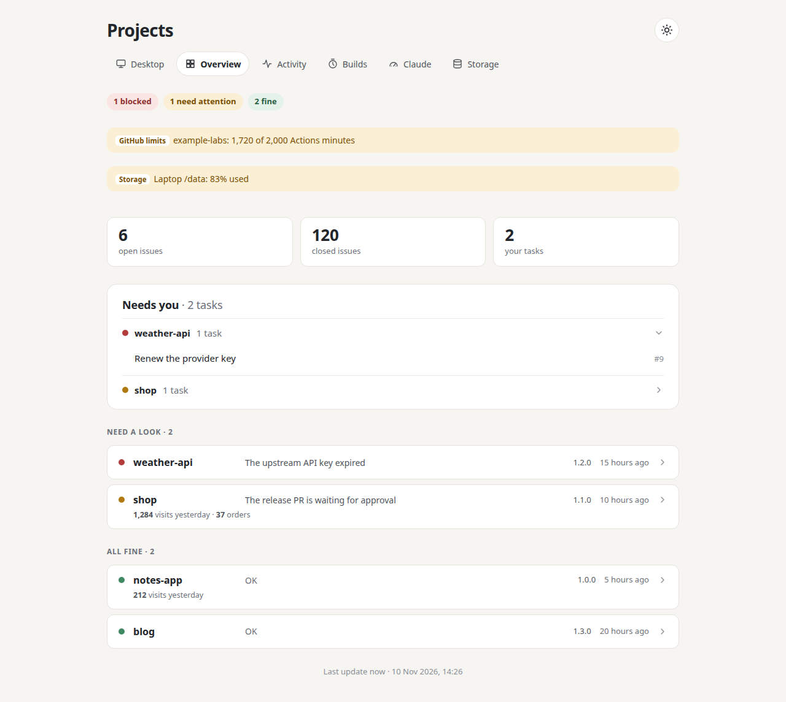
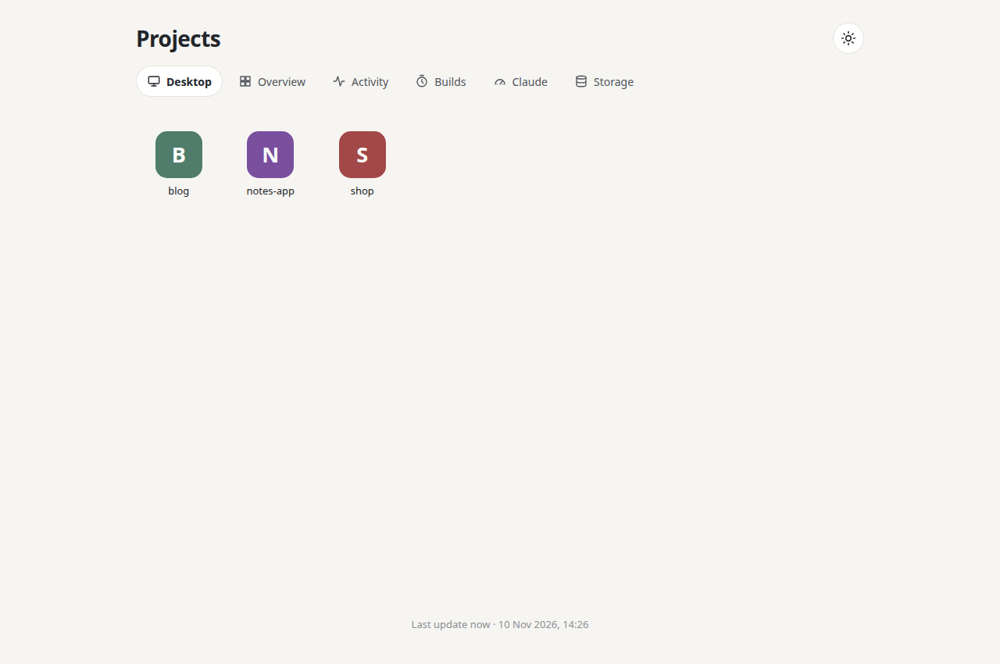
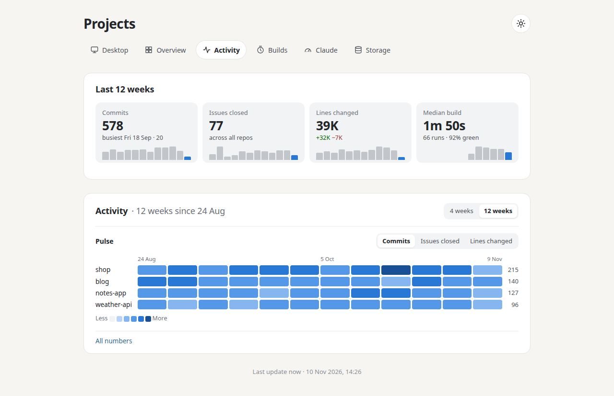
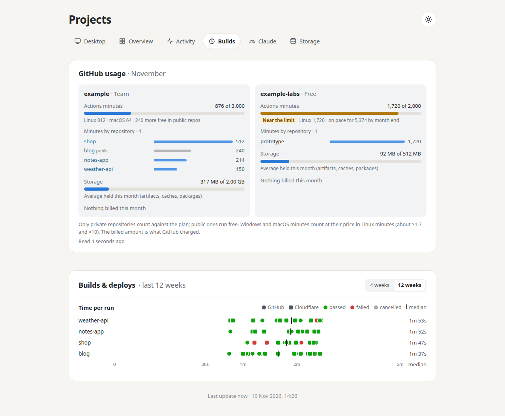
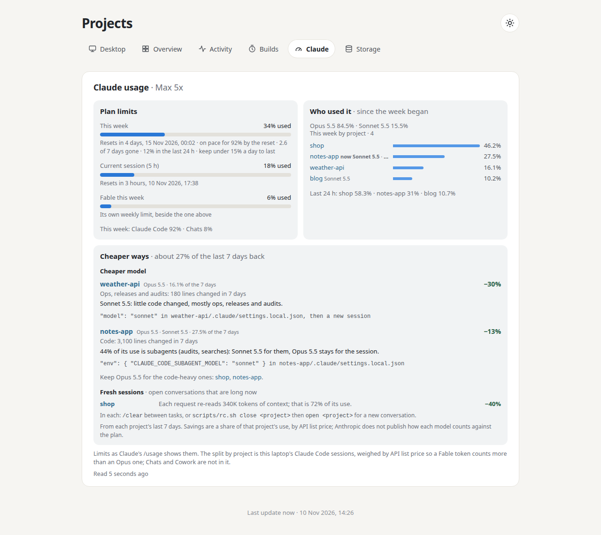
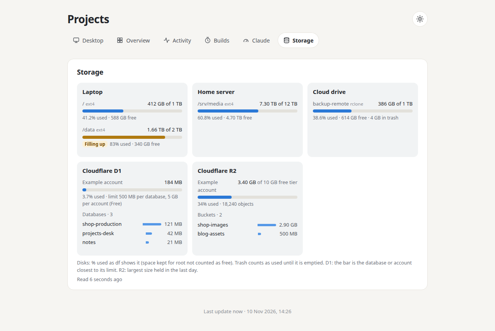

# projects-desk

A private dashboard of all your projects, kept up to date by the Claude Code
sessions that work on them.



Each project's Claude Code session writes one small JSON file: versions,
health, what is waiting on you, next steps. A watcher on your computer copies
those files into a Cloudflare D1 database, and a Cloudflare Worker renders the
page from D1 on every request. A status change shows on the next page load,
with no commit and no deploy.

## What you get

- **Desktop**: an icon for each project's live app.
- **Overview**: what needs you, across every project.
- **Activity and Builds**: commits, lines changed and build times per project,
  plus GitHub Actions usage per account.
- **Storage** (optional): used and free space on your disks, servers, rclone
  remotes, D1 and R2.
- **A page per project**, with its owner tasks, issues and next steps.
- **An installable app** (PWA) that also works on a phone.
- **Claude Code sessions on demand** (optional, Linux only): open and close one
  tmux session per project, reachable from your phone over Remote Control.

There is no framework. The only dependency is `wrangler`.

## Screenshots

Every tab, with demo data and with the optional Claude tab turned on.

| | |
|---|---|
| **Desktop** | **Overview** |
|  |  |
| **Activity** | **Builds** |
|  |  |
| **Claude** | **Storage** |
|  |  |

## What you need

- A computer running Windows, macOS or Linux. The watcher and timers run there.
  On Windows it needs PowerShell only: no WSL and no bash.
- Node.js 22 or newer, `git`, and `gh` (logged in).
- A Cloudflare account with a domain on it. The Worker, D1 and Access all run on
  Cloudflare.
- Claude Code, for the sessions that write the status files.
- Optional, Linux only: [agy](#sessions-with-agy), if you want `rc.sh` to open
  sessions with Google's Antigravity CLI as well.

The page lists private issue titles, so it must not be public. The setup puts it
behind Cloudflare Access, and `npm run deploy` fails if a custom domain answers
without an Access login.

### Sessions with agy

`scripts/rc.sh open --agent agy <project>` opens a project with agy (Google
Antigravity CLI) instead of Claude Code, which stays the default. It starts agy
in a window of its own tmux session, `agy-rc`, and prints the
`https://antigravity.google.com/r/<id>` link that lets you watch and drive the
session from the browser. `rc.sh list` shows both kinds, with an AGENT column,
and `rc.sh close --force --agent agy <project>` ends an agy session (agy does not say
whether it is working, so a plain `close` refuses; `--agent agy` matters when the
project also has a Claude Code session, which `close` picks otherwise). The link stays the same
when the same folder is reopened. Idle-close never touches agy sessions.

agy is a prerequisite, like Claude Code: `rc.sh` neither installs it nor signs
in for you, and `open --agent agy` stops with a pointer to this section when
agy is missing or signed out.

1. Install it with the official script. Read it first; it needs no sudo and
   installs to `~/.local/bin`:
   `curl -fsSL https://antigravity.google.com/cli/install.sh | bash`.
   If `~/.local/bin` is not in your `PATH`, the installer warns; add it.
2. Sign in once: run `agy` with no arguments and follow the prompt. Over ssh it
   prints a URL to open in a browser. `agy models` prints the models once you
   are signed in and fails when you are not; that is the check `rc.sh` makes.
3. Choose a model from `agy models` and put it in `desk.config.json`:
   `"agy": { "model": "<id>" }`. Quota is per model, so one can be used up while
   another still works.
4. A folder agy has not seen asks "Do you trust this folder"; `open` then exits
   with code 3 and names the tmux window where you answer it.

agy reads `AGENTS.md` and `GEMINI.md` from the project folder, but not
`CLAUDE.md` (tested with agy 1.5.15). A project that should instruct both needs
an `AGENTS.md`.

## Get started

```sh
git clone <this repository> projects-desk
cd projects-desk
npm install
npm test
npm run dev   # http://localhost:8787, an empty dashboard from local files
```

In PowerShell on Windows, write `npm.cmd` instead of `npm`. Plain `npm` starts a
`.ps1` script, and Windows blocks those by default.

Then follow [docs/SETUP.md](docs/SETUP.md) to create the database, protect the
domain, deploy and install the watcher. It starts with a prompt you can give
Claude Code to do this for you. After that,
[docs/CLAUDE_CODE.md](docs/CLAUDE_CODE.md) has the text that tells your Claude
Code sessions to write their status files.

The status file format is in
[STATUS_INSTRUCTIONS.md](STATUS_INSTRUCTIONS.md). Internals are in
[CLAUDE.md](CLAUDE.md).

## The Claude usage tab

An optional tab shows your Claude plan limits and which projects used them. It
is **off by default** (`"claude": false` in `desk.config.json`).

It reads `api.anthropic.com/api/oauth/usage`, the endpoint Claude Code's own
`/usage` command reads, using the Claude login on your computer. **That endpoint
is unofficial and undocumented.** It can change or disappear at any time, and it
may not be something Anthropic intends other tools to call, so read the terms
that apply to your plan before turning this on. The token is never logged or
stored, and a changed response shows as a problem on the tab with the last good
reading kept.

## License

[MIT](LICENSE)
